

  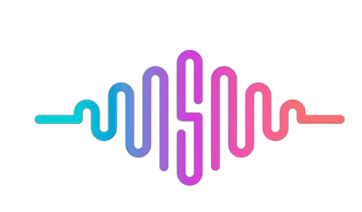

<h1 align="center">Soundstage</h1>

  <b>Audio synthesis with context-aware voice inflections &amp; environmental sounds</b> 
  Final Year Project, BS Computer Science · GIK Institute of Engineering Sciences &amp; Technology · 2023

  
  
  
  

  <a href="docs/Soundstage-Final-Report.pdf"><b>📄 Final report (51 pp.)</b></a> ·
  <a href="docs/Soundstage-Product-Requirements.pdf">Requirements document</a> ·
  <a href="assets/poster.jpg">Poster</a>

---

> [!NOTE]
> This repository documents the **design, architecture and research** behind Soundstage. The source code is not included: the prototype was a work in progress when the project ended.
>
> The app is no longer functional because its servers have been shut down.

## Contents

- [Overview](#overview)
- [Screenshots](#screenshots)
- [How it works](#how-it-works)
- [System architecture](#system-architecture)
- [Research: diffusion-based audio synthesis](#research-diffusion-based-audio-synthesis)
  - [U-Net building blocks](#u-net-building-blocks)
  - [Text-conditional diffusion generator](#text-conditional-diffusion-generator)
  - [Diffusion vocoder](#diffusion-vocoder)
  - [U-Net vocoder evaluation](#u-net-vocoder-evaluation)
- [Project status](#project-status)
- [Tech stack](#tech-stack)
- [Future work](#future-work)
- [Team](#team)
- [References](#references)

## Overview

Soundstage is a web application that turns a piece of natural text, such as an extract from a novel, into an audio scene. It finds the dialogue in the text, works out who is speaking and what mood the scene is in, and synthesizes each line in a voice that fits the character. In its extended scope it also figures out where the scene is set and generates matching environmental sound (rain, rustling leaves, a flowing river).

Existing text-to-speech tools at the time (Sonantic, Murf.AI, Play.ht) produced high-quality voices but required a person to enter each line, choose a voice and set the emotion by hand. Soundstage's aim was to derive all of that from the text itself.

**Who it was for:** teachers in under-resourced schools who want audiobooks for their classes, visually impaired listeners, independent filmmakers and game developers who can't afford voice actors or a foley artist, and audio platforms producing audiobooks at scale.

## Screenshots

| Landing page | Synthesis tool, Auto mode |
| :---: | :---: |
| 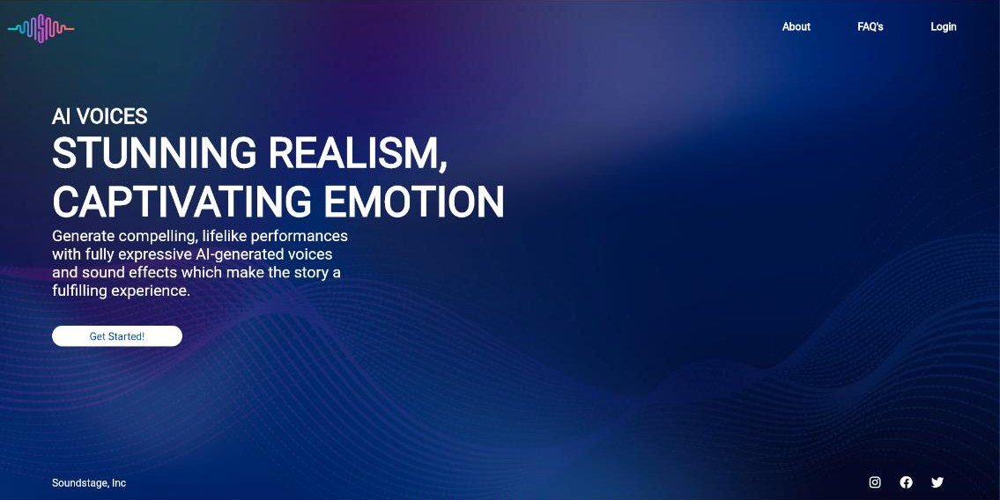 | 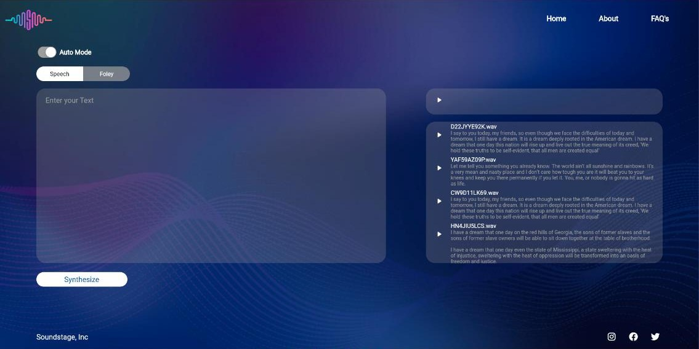 |
| **Manual mode: speech** (age, sex, emotion) | **Manual mode: foley** (rhythmic / non-rhythmic) |
| 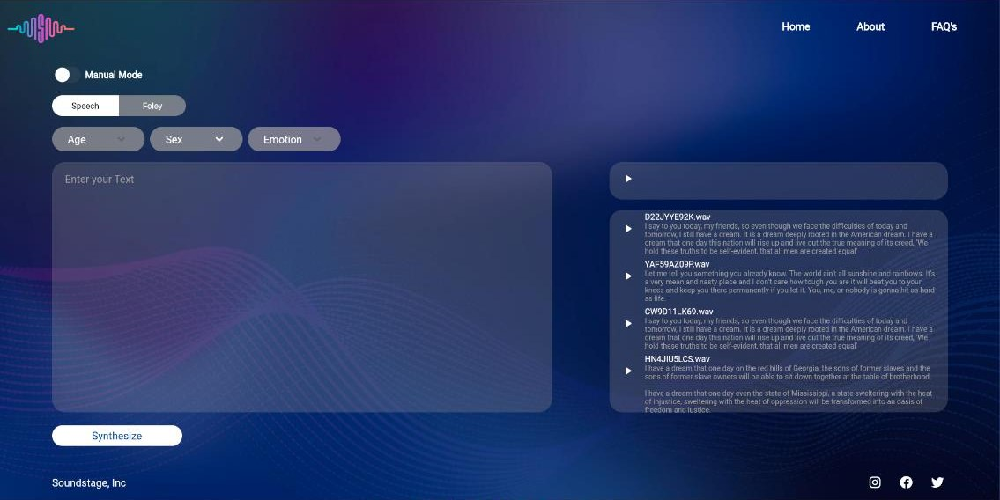 | 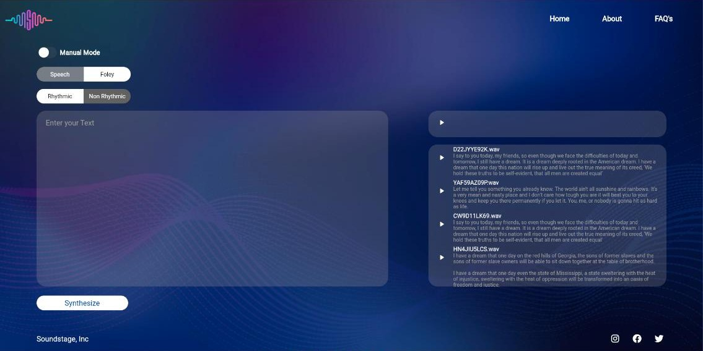 |

More screens: About, FAQ, Login

| About | FAQ | Login |
| :---: | :---: | :---: |
| 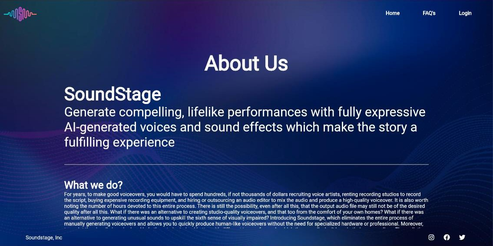 | 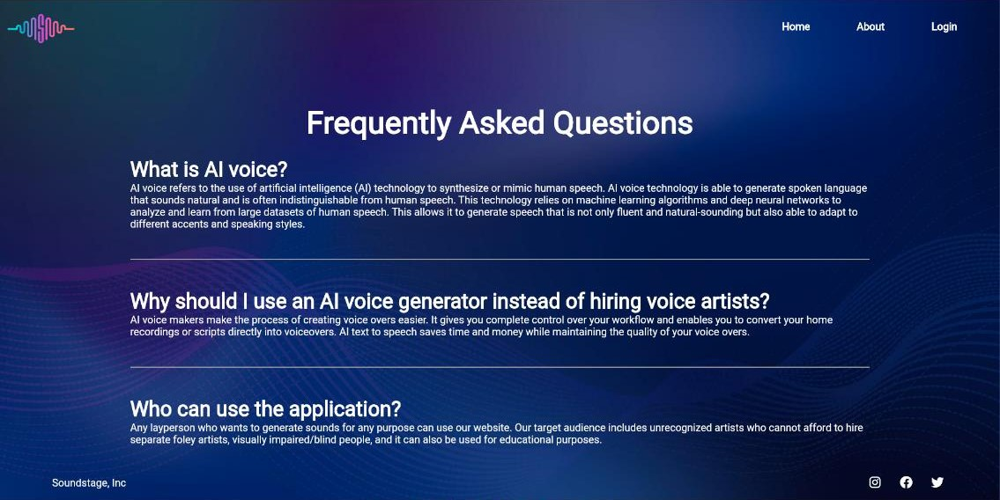 | 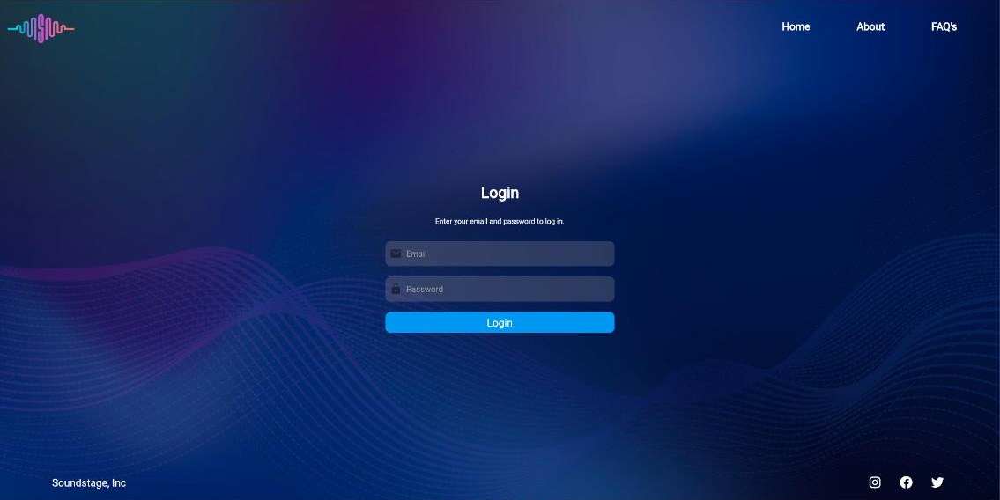 |

## How it works

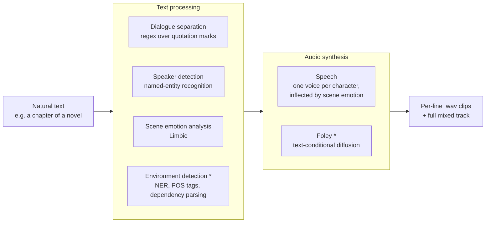

* Extended scope, see <a href="#project-status">project status</a>.

1. **Dialogue separation.** Dialogue in prose follows a consistent pattern (text enclosed in quotation marks), so regular expressions extract it reliably and cheaply.
2. **Speaker detection.** Named-entity recognition (NLTK, Stanford CoreNLP, spaCy) identifies who each line belongs to, so every character keeps a distinct, recognizable voice. DistilBERT models and a separate NER pipeline were also tried.
3. **Scene emotion analysis.** Emotion is computed once per scene with the Limbic library, not per line, which keeps compute cost manageable while still giving voices the right tone.
4. **Environment detection.** NER, part-of-speech tagging and dependency parsing (spaCy, NLTK) pick out the setting, such as a forest or a seaside, to drive foley generation.

Users can let the app do all of this (**Auto mode**) or set each character's age, sex and emotion themselves (**Manual mode**).

## System architecture

The report describes the system with the **4+1 architectural view model**. Physically, the front end and data live on Firebase, and all heavy computation runs on a separate processing server.

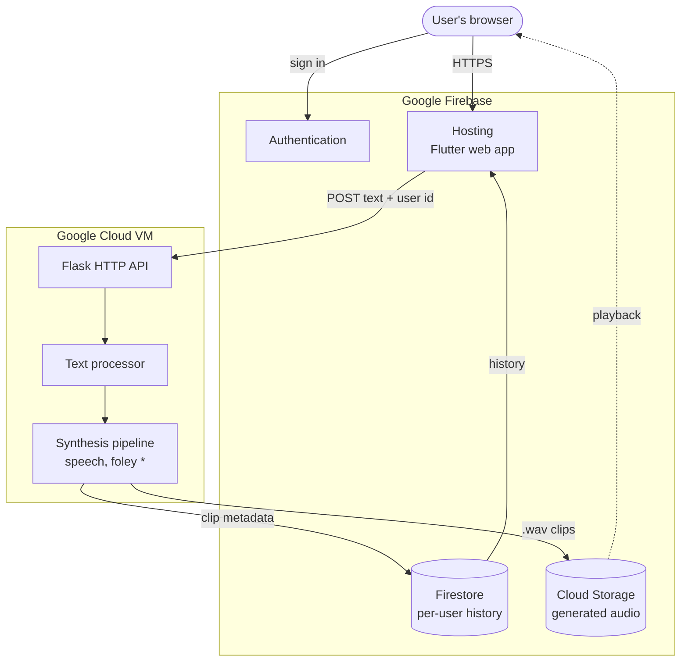

### Request lifecycle

Synthesis can take minutes, so the API replies straight away with a job ID and does the work on a background thread. The web app picks up the results from Firestore as each clip is written.

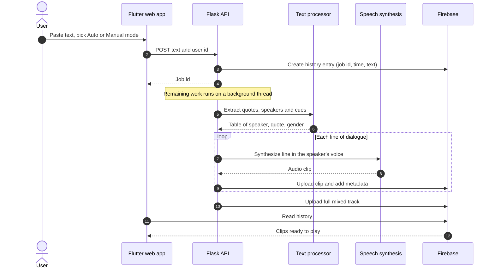

### UML views from the report

<b>Use case view</b>: register/login, input text, select mode, select characteristics, generate audio

 
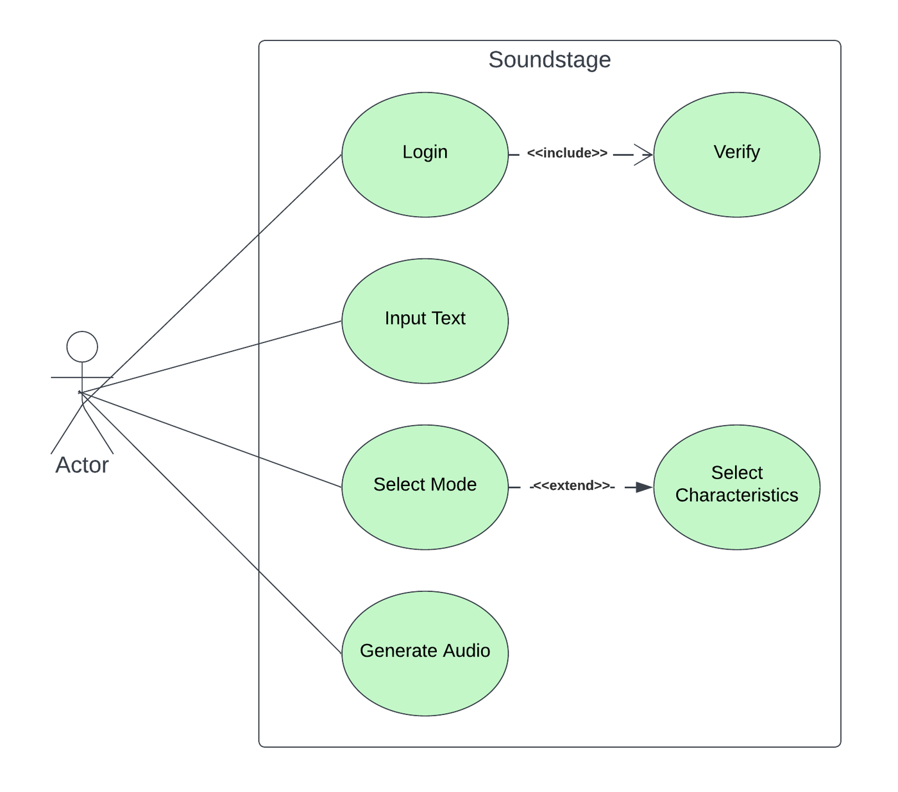

<b>Process view</b>: activity diagram of the Auto and Manual flows

 
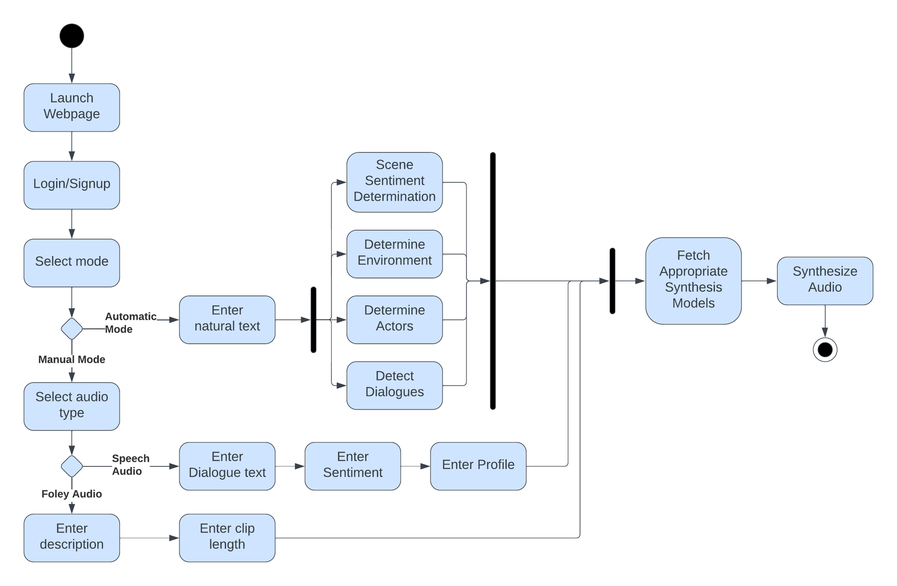

<b>Physical view</b>: deployment diagram

 
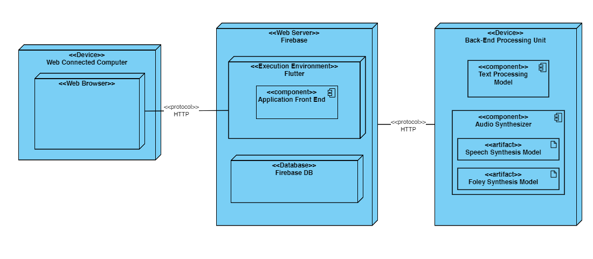

<b>Development view</b>: three components

 

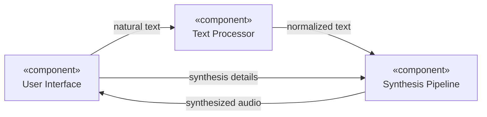

## Research: diffusion-based audio synthesis

Denoising diffusion, the approach behind image generators like DALL·E 2 and Midjourney, was the core research direction. Images and audio are different kinds of data, so the pipeline converts audio to and from (mel) spectrograms and uses **1D U-Nets** as the denoiser. The work builds on Flavio Schneider's *ArchiSound* [[3]](#references) and its open-source `a-unet` library.

### U-Net building blocks

A U-Net is an encoder–decoder network with skip connections that preserve fine detail at every resolution. Here it is assembled recursively from **blocks**:

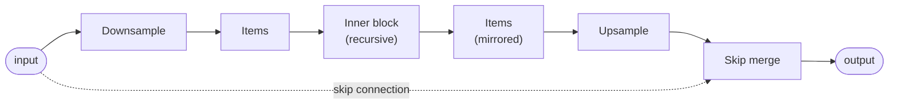

Each block runs a stack of **items**, the processing units at that resolution:

| Item | Code | What it does |
| --- | :---: | --- |
| ResnetItem | **R** | Convolutional processing |
| ModulationItem | **M** | Modulates channels from a feature vector (e.g. the diffusion time step) |
| AttentionItem | **A** | Self-attention between region vectors |
| CrossAttentionItem | **C** | Cross-attention to external embeddings (e.g. text) |
| FeedForwardItem | **F** | MLP-style processing of region vectors |
| InjectItem | **I** | Injects external channels (e.g. a conditioning signal) |

Conditioning can enter through feature vectors, embeddings or extra channels. **Plugins** such as time conditioning and classifier-free guidance wrap the U-Net without changing the network itself.

### Text-conditional diffusion generator

**Why text conditioning.** Frozen pretrained language models already steer image diffusion toward a text prompt, so the same should work for audio. For Soundstage, that means describing a sound effect in words ("rain on a tin roof") and generating it. The same model could later produce background music too.

**Method.** A frozen **T5** transformer encodes the description into an embedding. The U-Net attends to it through cross-attention blocks at several resolutions. Training clips have a fixed length, so each description gets a chunk tag (e.g. *"1 of 4"*) to say which part of a longer clip the model is looking at.

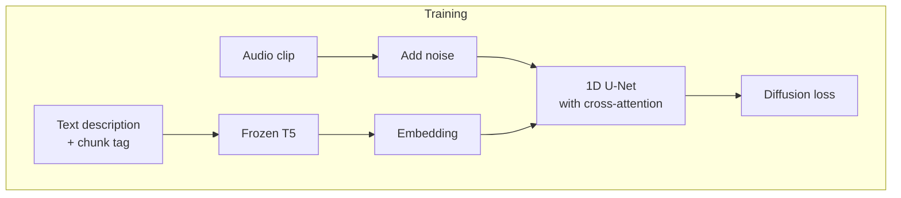

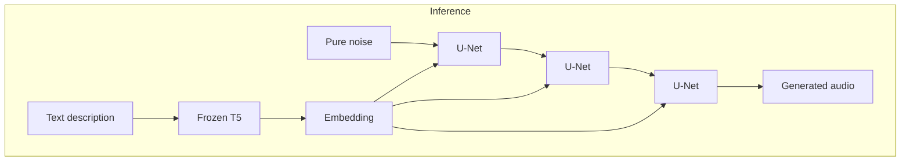

| Training setup (final presentation) | |
| --- | --- |
| Optimizer | AdamW |
| Steps | 1M |
| Batch size | 32 |
| Data | Audiobooks |
| Clip size | 2²¹ samples (~44 s at 48 kHz) |

**Result.** Text conditioning worked well: generated audio matched its description. Used directly as a text-to-speech model, however, the output was **mostly unintelligible**. Foley was in the extended scope, so this component was not taken further.

### Diffusion vocoder

**Why.** Mel spectrograms weight frequencies the way human hearing does, which makes them a good intermediate representation. Turning a spectrogram back into a waveform without losing detail is hard, though. Iterative methods like Griffin-Lim leave audible artifacts. ArchiSound proposes a small change that turns the same U-Net into a high-quality **vocoder**.

**Method.** The mel spectrogram is *flattened* back to waveform length with a learned **transposed 1D convolution**. That flattened signal is fed to the U-Net as extra channels next to the noisy waveform being denoised.

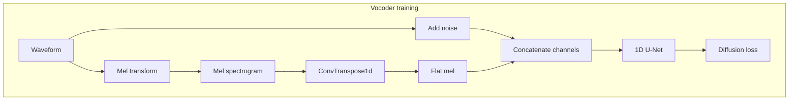

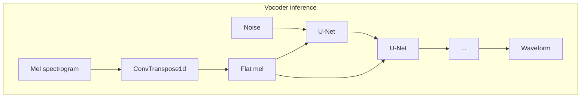

The key is lining the transposed convolution up with the STFT that produced the spectrogram. An STFT is effectively a 1D convolution with long sine and cosine windows, followed by a magnitude and a mel projection. Neither of those last two steps changes the time axis. So if the convolution mirrors the STFT's geometry, each output region covers exactly the stretch of waveform its spectrogram frame came from:

| STFT parameter | Transposed-convolution parameter |
| --- | --- |
| Window length | Kernel size |
| Hop length | Stride |
| Padding / centering | Matching padding |

### U-Net vocoder evaluation

- **High-quality waveforms.** The diffusion vocoder reconstructed high-fidelity audio from mel spectrograms, *as long as* the U-Net has enough convolutional (ResNet) blocks at its first, highest-resolution stage. Those blocks are what recover the high frequencies.
- **Capacity scales with mel channels (hypothesis).** Following ArchiSound's author, more mel channels should improve quality for two reasons. The spectrogram discards less information, and the transposed convolution gets more channels to flatten, so it has more capacity.
- **Text-conditional TTS fell short.** The same diffusion backbone matched text descriptions well for general audio but did not produce intelligible speech.

The evaluation was qualitative. No objective metrics were reported. Full details are in chapters 4–5 of the [final report](docs/Soundstage-Final-Report.pdf).

## Project status

The base scope (text processing, 1–2 voice models, automatic synthesis, integrated web app) was delivered. The extended scope was still in development when the project ended.

| Component | Status (May 2023) |
| --- | --- |
| Web app: Flutter UI, Firebase auth, history, playback | ✅ Done |
| Integration: web app ↔ Flask API ↔ Firebase | ✅ Done |
| Voice synthesis | ✅ Done |
| Text analysis: dialogue separation, speaker detection | 🟡 Partial: speakers are found only when attribution follows a standard structure (e.g. *"…," said Tom*) |
| Diffusion vocoder | 🔬 Research prototype, high-quality reconstructions |
| Text-conditional diffusion | 🔬 Research prototype, good for described sounds, unintelligible as TTS |
| Foley synthesis * | 🚧 In progress (extended scope) |
| 3–4 voice models, environment detection * | 🚧 Extended scope, not implemented |

**Known limitations:** English-only input; varied writing styles can confuse text processing; emotion in speech is not always as intended; some words are mispronounced because of dataset gaps; scaling currently means redeploying the whole server.

## Tech stack

| Layer | Tools |
| --- | --- |
| Design | Figma |
| Front end | Flutter (Dart), Roboto |
| Hosting & data | Firebase Hosting, Authentication, Firestore, Cloud Storage |
| Back end | Python, Flask on a Google Cloud VM |
| NLP | spaCy, textacy, NLTK, Stanford CoreNLP, Limbic, pandas |
| Audio ML | PyTorch, TensorFlow, `a-unet` (ArchiSound), T5 text encoder |
| Tested on | Chrome, Firefox, Edge |

## Future work

1. **Better text processing.** Handle complex dialogue attribution and finer-grained detail.
2. **More control.** Let users specify emotion and other generation parameters explicitly.
3. **More models.** Add voices, accents and languages, plus background music generation.
4. **Foley generation.** Finish text-conditional sound-effect synthesis.
5. **Timeline editor.** Trim and arrange generated clips in the app.
6. **Scalability.** Move beyond redundant whole-server deployments.

## Team

| | |
| --- | --- |
| **Students** | Asad Shahab · Shams Ghani · Syed Nazim Shah · Maida Shafaq |
| **Advisor** | Dr. Zahid Halim |
| **Co-advisor** | Engr. Ahsan Shah |
| **Institution** | Faculty of Computer Science & Engineering, Ghulam Ishaq Khan Institute of Engineering Sciences & Technology |

Poster

 
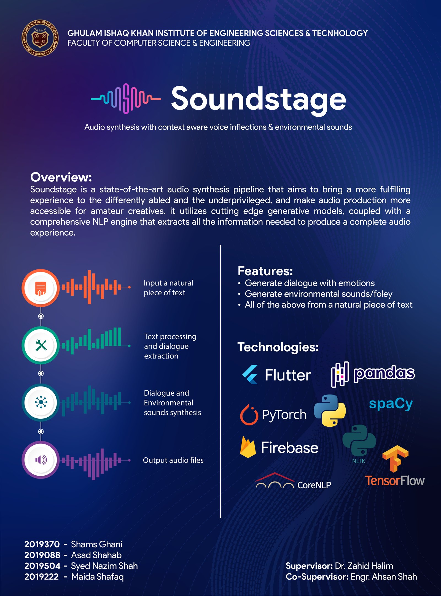

## References

1. Z. Kong, W. Ping, J. Huang, K. Zhao, B. Catanzaro. *DiffWave: A Versatile Diffusion Model for Audio Synthesis.* 2021. [arXiv:2009.09761](https://arxiv.org/abs/2009.09761)
2. J. Shen et al. *Natural TTS Synthesis by Conditioning WaveNet on Mel Spectrogram Predictions* (Tacotron 2). 2018. [arXiv:1712.05884](https://arxiv.org/abs/1712.05884)
3. F. Schneider. *ArchiSound: Audio Generation with Diffusion.* 2023. [arXiv:2301.13267](https://arxiv.org/abs/2301.13267)
4. C. D. Manning et al. *The Stanford CoreNLP Natural Language Processing Toolkit.* 2014. [PDF](https://nlp.stanford.edu/pubs/StanfordCoreNlp2014.pdf)

---

© 2023 the Soundstage team. All rights reserved. Figures in this README were redrawn for this repository. Diagram images and screenshots are from the team's own report.
